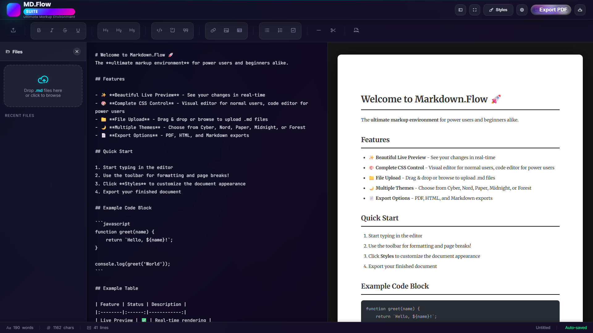

<div align="center">

# ✒️ Markdown.Flow

**Write Markdown on the left, get a beautiful, print-ready document on the right.**

A browser-based Markdown editor with a live preview, a visual style editor and one-click export to PDF, HTML or `.md`. No install, no account, no server: everything stays in your browser.

<!-- INSTALL BUTTONS START -->
<p align="center">
  <a href="https://professorquantumuniverse.github.io/Markdown.Flow/"></a>
</p>
<!-- INSTALL BUTTONS END -->



</div>

---

## ✨ Features

- **Live preview** that renders as you type, with syntax-highlighted code blocks
- **Toolbar for everything**: headings, bold/italic/strikethrough/underline, lists, task lists, quotes, code, links, images, tables and horizontal rules
- **Page breaks** so your PDF splits exactly where you want it
- **Style editor** for fonts, sizes, line height, page padding and colours, plus a CSS code editor if you want full control
- **Five interface themes**: Cyber, Nord, Paper, Midnight and Forest
- **Export** to PDF, standalone HTML or plain Markdown
- **Drag & drop** `.md` files straight into the editor, with a list of recent files
- **Zen mode** for distraction-free writing
- **Auto-save** to your browser's local storage, plus live word, character and line counts

## 🚀 Usage

Just open the [web app](https://professorquantumuniverse.github.io/Markdown.Flow/) and start typing.

To run it locally, clone the repo and open `index.html` in any modern browser. There is no build step.

```bash
git clone https://github.com/ProfessorQuantumUniverse/Markdown.Flow.git
```

## 🛠️ Built with

Plain HTML, CSS and JavaScript, plus [marked](https://github.com/markedjs/marked) for parsing, [highlight.js](https://highlightjs.org/) for code, [html2pdf.js](https://github.com/eKoopmans/html2pdf.js) for PDF export and [Phosphor Icons](https://phosphoricons.com/).

## 🔒 Privacy

Your documents never leave your device. Content, settings and recent files live in your browser's `localStorage` only.
